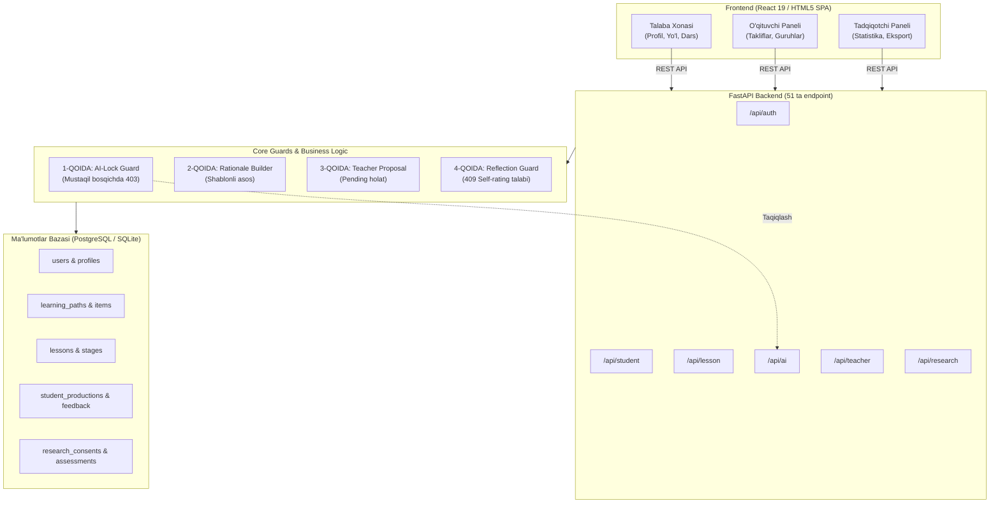

# 🌟 TILORA — Adaptiv Ta'lim Veb-Platformasi

**Ingliz tilini sun'iy intellekt texnologiyalari asosida o'qitishning tabaqalashtirilgan adaptiv-metakognitiv modeli**

> 🏛️ **Pedagogika fanlari bo'yicha falsafa doktori (PhD) / fan doktori (DSc) dissertatsiyasi doirasida yaratilgan dasturiy majmua.**  
> 📍 **Muassasalar:** Buxoro davlat universiteti (BuxDU), Nukus davlat pedagogika instituti (NDPI), Samarqand davlat chet tillar instituti (SamDChTI).

---

## 🧭 1. Loyihaning To'rt Mutlaq Qoidasi (Core Pedagogical Rules)

Tilora oddiy til o'rgatuvchi ilova emas. Uning pedagogik va ilmiy mohiyati quyidagi to'rt tamoyilga asoslanadi:

```
┌────────────────────────────────────────────────────────────────────────┐
│                        TILORA TO'RT QOIDASI                            │
├────────────────────────────────────────────────────────────────────────┤
│ 1. AI O'CHIRILADI       Mustaqil bosqichda yordam majburiy yopiladi   │
│ 2. SABAB KO'RSATILADI   Har bir qaror deterministik shablondan chiqadi │
│ 3. QAROR O'QITUVCHIDA   Tizim faqat taklif qiladi, inson tasdiqlaydi   │
│ 4. TALABA XULOSA QILADI Tizim baho xulosasi bermaydi, talaba yozadi   │
└────────────────────────────────────────────────────────────────────────┘
```

1. **1-qoida: Mashg'ulotning markaziy bosqichida AI yordami majburiy o'chiriladi.**  
   Talaba o'z aqliy mehnati bilan matn yaratmaguncha tayyor generatsiya berilmaydi. Server tomonda `403 AI_LOCKED` qaytariladi.
2. **2-qoida: Tizim o'z qarorini hech qachon yashirmaydi.**  
   Har bir material va tavsiya yonida `rationale` (asoslangan sabab) turadi. Sabab LLM emas, deterministik shablondan olinadi.
3. **3-qoida: Yakuniy pedagogik qaror har doim o'qituvchida.**  
   Tizim taklif yuboradi (`status: pending`), o'qituvchi tasdiqlamasa dastur o'zgarmaydi.
4. **4-qoida: Xulosani tizim emas, talaba chiqaradi.**  
   Metakognitiv refleksiya bosqichida talaba avval o'zini baholaydi (`self-rating`), shundan keyingina haqiqiy natija ko'rsatiladi (`actual-rating`). Tizim xulosa yozmaydi, talaba farq sababini o'zi tahlil qiladi.

---

## 🏗️ 2. Arxitektura Diagrammasi (Mermaid)



---

## ⚡ 3. Tezkor Ishga Tushirish (Quickstart)

### 1-variant: Bir marta bosish bilan (Avtonom rejim)
* `C:\Users\HP\Desktop\TILORA\start.bat` faylini ikki marta bosing.  
* Brauzeringizda to'liq interaktiv platforma darhol ochiladi!

### 2-variant: Backend serveri bilan to'liq ishga tushirish
1. Terminalni oching va loyiha papkasiga o'ting:
   ```powershell
   cd C:\Users\HP\Desktop\TILORA\backend
   ```
2. Kerakli paketlarni o'rnating:
   ```powershell
   pip install -r requirements.txt
   ```
3. Boshlang'ich demo ma'lumotlarni yuklang:
   ```powershell
   python seed.py
   ```
4. Serverni ishga tushiring:
   ```powershell
   uvicorn app.main:app --port 8010 --reload
   ```
5. Brauzerda oching:
   - Platforma interfeysi: `http://127.0.0.1:8010`
   - Interaktiv Swagger hujjatlari: `http://127.0.0.1:8010/docs` (faqat `DOCS_ENABLED=true` bo'lsa)
   - Avval `.env.example` ni `.env` ga nusxalab, `AI_API_KEY` ni to'ldiring (kalitsiz AI funksiyalari lokal algoritm bilan ishlaydi)

---

## 🧪 4. Avtomatlashtirilgan Testlarni Tekshirish

Pedagogik qoidalar va algoritmlarni tekshirish uchun:
```powershell
cd C:\Users\HP\Desktop\TILORA\backend
python run_tests.py
```

Natija:
```
....
----------------------------------------------------------------------
Ran 4 tests in 0.001s

OK
 [PASS] L1 interferensiyasi: 4 ta ona tili xatosi kalitsiz aniqlandi.
 [PASS] Ob'ektiv baholash: Ball 75/100 hisoblandi.
 [PASS] 1-qoida / Metodika: Tashvish qoidasi to'g'ri ishladi.
 [PASS] 2-qoida: Shablondan sabab yaratish to'g'ri ishladi.
```

---

## 🔐 4.1. Xavfsizlik sozlamalari (v2.1)

* **Maxfiy kalitlar faqat `.env` da** (git'ga qo'shilmaydi). Namuna: `.env.example`. `SECRET_KEY` bo'sh qoldirilsa avtomatik yaratilib `.secret_key` fayliga saqlanadi.
* **Parollar:** foydalanuvchiga xos tuzli PBKDF2-SHA256 (600 000 iteratsiya); eski xeshlar kirishda avtomatik yangilanadi. Minimal uzunlik 8, harf + raqam.
* **Login himoyasi:** IP va login bo'yicha urinishlar chegarasi (429), foydalanuvchi mavjudligini oshkor qilmaydigan xabar.
* **Sessiya:** JWT 12 soat; rol va obuna har so'rovda bazadan tekshiriladi.
* **Mashg'ulot holati** foydalanuvchi bo'yicha alohida (avvalgi umumiy `LESSON_CACHE` olib tashlandi); AI qulfi (1-qoida) serverdagi holat bo'yicha hal qilinadi.
* **AI endpointlari** faqat tizimga kirganlar uchun, foydalanuvchi bo'yicha chegara bilan.
* **Eksport** (.docx/.xlsx/.csv) faqat tadqiqotchi / o'qituvchi / admin uchun.
* Path traversal himoyasi, CSP va boshqa xavfsizlik sarlavhalari, so'rov hajmi chegarasi (`MAX_UPLOAD_MB`), nginx `limit_req`.
* Ishlab chiqarishda: `DOCS_ENABLED=false`, `ALLOWED_ORIGINS=https://domen`, `docker compose` maxfiy qiymatlarsiz ishga tushmaydi.

> ⚠️ Avvalgi versiyada AI kaliti va `tilora.db` git tarixiga tushib qolgan. Provayder kabinetida eski kalitni **bekor qilib**, yangisini `.env` ga yozing; demo hisoblar parolini o'zgartiring.

## 📚 4.2. Ma'lumotnoma (kontent) API

`/api/content/*` — ochiq: `overview`, `glossary` (50 ELT atamasi, qidiruv/toifa), `cefr-levels` (A1–C2, 4 ko'nikma + o'qituvchi treki), `l1-patterns` (44 o'zbek–ingliz interferensiya naqshi), `methodology` (muammo, 4 qoida, 5 bosqich, taqqoslash, adabiyotlar), `faq`, `curriculum`. Saytda: yon menyu → "Platforma haqida, glossariy, CEFR".

## 👥 5. Demo Hisoblar Ma'lumotlari

Demo hisoblar paroli `SEED_PASSWORD` muhit o'zgaruvchisi bilan belgilanadi (standart: `tilora2026!`, faqat lokal demo uchun; ishlab chiqarishda o'zgartiring).

| Rol | Login | Vazifasi va ko'rinishi |
|---|---|---|
| **Talaba (Tajriba)** | `talaba01@tilora.uz` | 3 o'lchovli profil, 16 haftalik yo'l, 5 bosqichli mashg'ulot |
| **Talaba (Nazorat)** | `talaba13@tilora.uz` | An'anaviy o'quv yo'li (adaptiv qismlar ataylab yopiq) |
| **O'qituvchi** | `oqituvchi1@tilora.uz` | 2 ta guruh, talabalar profili, takliflarni tasdiqlash paneli |
| **Tadqiqotchi** | `tadqiqotchi@tilora.uz` | Guruhlar tengligi (Chi-square), t-mezon, Cohen's d, eksport |
| **Administrator** | `admin@tilora.uz` | 3 ta OTM, 25 ta jadval, tizim xavfsizligi auditi |

---

## 📊 6. Tizim Ko'rsatkichlari

* **Backend:** 51 ta RESTful endpoint, FastAPI, SQLAlchemy, Pydantic v2
* **Frontend:** Fraunces & Public Sans tipografiyasi, Tailwind semantikasi, adaptiv SPA
* **Ma'lumotlar modeli:** 25 ta reliesion jadval, to'liq audit jurnali (`audit_log`)
* **Kontent banki (standart to'plam):** 24 ta diagnostika savoli (4 ko'nikma × A2–C1), 20 ta FLCAS asosidagi anketa bandi, 12 ta kasbiy mavzu, 44 ta ona tili (L1) naqshi, 50 ta glossariy atamasi, 4 ko'nikma uchun mashg'ulot topshiriqlari, 16 ta ilmiy manba
* **Testlar:** `cd backend; python -m pytest -q` — 61 ta test (xavfsizlik regressiyasi `tests/test_security.py`)
